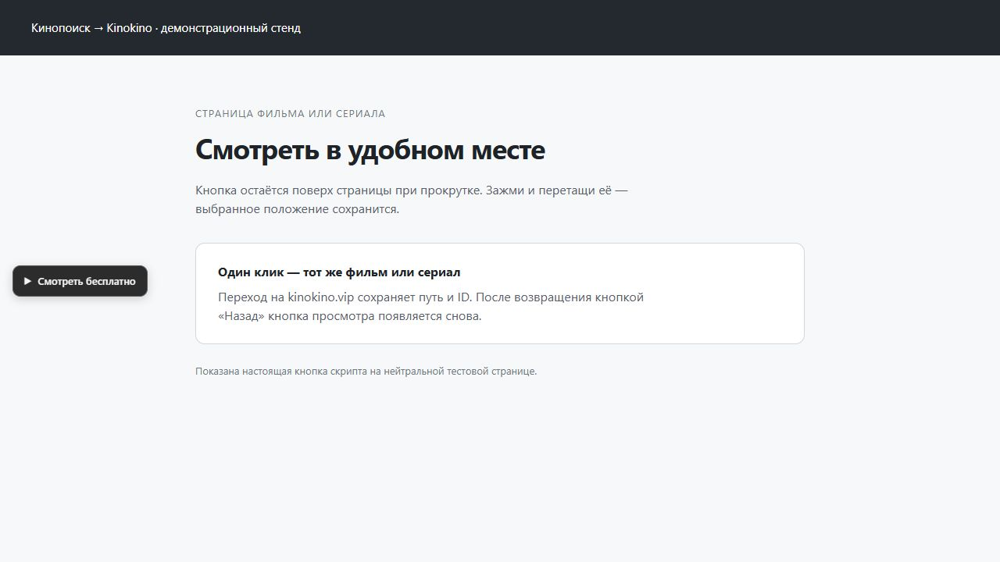

<div align="center">
  <h1>▶ Кинопоиск → Kinokino</h1>
  <p>Кнопка «Смотреть бесплатно» на страницах фильмов и сериалов Кинопоиска.</p>
  <p>
    <a href="https://github.com/GameModify/kinopoisk-extension/releases/latest/download/kinopoisk-kinokino.user.js"><strong>Скачать скрипт</strong></a> ·
    <a href="#быстрый-старт">Установить</a> ·
    <a href="https://github.com/GameModify/kinopoisk-extension/releases/latest">Открыть релиз</a>
  </p>
  <p>
    
    <a href="https://github.com/GameModify/kinopoisk-extension/releases/tag/v1.3.1"></a>
    <a href="LICENSE"></a>
  </p>
</div>

**Небольшая серая кнопка открывает соответствующий адрес на `kinokino.vip` в той же вкладке.** Путь, ID, параметры и якорь сохраняются. Кнопку можно перетащить мышью или пальцем — выбранное положение запоминается.

## Быстрый старт

1. Установи [Tampermonkey](https://www.tampermonkey.net/) для своего браузера.
2. Скачай **[`kinopoisk-kinokino.user.js`](https://github.com/GameModify/kinopoisk-extension/releases/latest/download/kinopoisk-kinokino.user.js)**. В меню Tampermonkey выбери **«Создать новый скрипт»**, удали шаблон, вставь весь текст скачанного файла и сохрани (`Ctrl+S`).
3. Обнови страницу фильма или сериала на Кинопоиске. Кнопка появится **слева по центру экрана** и останется видимой при прокрутке.

Для установки нужен только браузер с Tampermonkey. Node.js и сборка не требуются. Скачивай файл `.user.js`; архивы **Source code** предназначены для работы с исходниками.

В Chrome может потребоваться разрешение **«Разрешить пользовательские скрипты»** в настройках Tampermonkey. Если менеджер показывает предупреждение, следуй [официальной инструкции](https://www.tampermonkey.net/faq.php#Q209).

## Как выглядит



_Демонстрационный стенд с настоящей кнопкой скрипта. На Кинопоиске она появляется поверх страницы фильма или сериала._

## Что умеет

| Возможность               | Как работает                                                               |
| ------------------------- | -------------------------------------------------------------------------- |
| **Переход к просмотру**   | Меняет домен на `kinokino.vip`, сохраняя адрес фильма или сериала          |
| **Удобное положение**     | Перетаскивание мышью или пальцем; кнопка остаётся в пределах окна          |
| **Запоминание координат** | Одно положение для фильмов, сериалов и следующих запусков браузера         |
| **Возврат без F5**        | Восстанавливается после браузерной кнопки «Назад» и переходов внутри сайта |
| **Сброс положения**       | Через меню Tampermonkey → «Сбросить положение кнопки»                      |

```text
https://www.kinopoisk.ru/series/160958/
                         ↓
https://kinokino.vip/series/160958/
```

Поддерживаются `kinopoisk.ru` и `www.kinopoisk.ru`, пути `/film/ID` и `/series/ID`, включая вложенные разделы. На главной, в поиске и на страницах персон кнопка не показывается.

> **Скрипт открывает ссылку.** Для страниц и просмотра нужен интернет; доступность стороннего сайта и видео зависит от `kinokino.vip`.

<details>
<summary><strong>Перемещение и сохранение положения</strong></summary>

Зажми кнопку основной кнопкой мыши или пальцем, перетащи и отпусти. После перетаскивания переход не выполняется; движение до 6 px считается обычным нажатием.

Положение хранится в Tampermonkey для этого скрипта и общее для адресов с `www` и без него. При изменении размера окна кнопка остаётся на экране. Отмена жеста возвращает прежнее положение; сброс доступен в меню Tampermonkey.

</details>

<details>
<summary><strong>Обновление и отсутствие кнопки</strong></summary>

Чтобы обновить уже установленный скрипт, замени весь его код содержимым актуального `.user.js`, сохрани и один раз перезагрузи вкладку Кинопоиска. Не создавай вторую копию.

В меню Tampermonkey на странице должен появиться пункт **«Показать кнопку Kinokino (1.3.1)»**. Его наличие подтверждает запуск скрипта; нажатием можно восстановить кнопку. Если пункта нет, проверь разрешение пользовательских скриптов и доступ Tampermonkey к `www.kinopoisk.ru`.

Shadow DOM и восстановление видимости защищают кнопку от типичных косметических фильтров блокировщиков. Отключать Adblock не требуется. Пользовательский фильтр, специально нацеленный на эту кнопку, может потребовать точечного исключения.

</details>

## Данные остаются в Tampermonkey

Сохраняется только выбранное положение кнопки. Скрипт не использует внешние библиотеки и не делает фоновых сетевых запросов. Переход на сайт просмотра происходит по нажатию кнопки.

<details>
<summary><strong>Устройство скрипта и проверка возврата</strong></summary>

Оформление изолировано через Shadow DOM и не зависит от CSS-классов Кинопоиска. При удалении кнопки, изменении видимости или восстановлении страницы скрипт возвращает её на место. Повторный запуск подключает обработчики к сохранённой кнопке без дубликатов таймеров.

Страховочный таймер сохраняется при уходе со страницы, поэтому возврат не зависит только от события `pageshow`. Временно недоступное API Tampermonkey не мешает показать кнопку, открыть ссылку или закончить перетаскивание. Основные стили и координаты восстанавливаются через CSSOM даже при потере узла стилей менеджера.

Для версии 1.3.1 проверен сценарий **«Смотреть бесплатно → Назад»** в установленном Tampermonkey: кнопка возвращается без ручного обновления. Стенд Node.js отдельно проверяет отказы API и события навигации.

</details>

<details>
<summary><strong>Разработка и проверки</strong></summary>

Нужны Node.js `24.21.0` и npm `11.19.0`. Версия Biome закреплена в lockfile.

```sh
cd /path/to/kinopoisk-extension
npm ci --ignore-scripts
npm run hooks:install
npm run verify
```

`verify` проверяет синтаксис, форматирование, lint и поведение в DOM-стенде Node.js. `.githooks/pre-push` и GitHub Actions запускают ту же проверку. На новом checkout установи hook командой выше. TypeScript, отдельная сборка, настройки окружения и секреты не требуются: устанавливается сам JavaScript-файл.

Для `.user.js` адресно отключена проверка `noRedundantUseStrict`: Tampermonkey исполняет обычный скрипт, а Biome предполагает модуль. Остальные рекомендованные правила включены; предупреждения lint блокируют проверку.

Node.js не заменяет проверку в Tampermonkey. При изменениях проверь фильм и сериал, переходы внутри сайта, «Назад», отсутствие кнопки в поиске, перетаскивание и сохранение положения на широком и узком экране.

[История версий](CHANGELOG.md) · [Локальная проверка](scripts/verify.cjs) · [GitHub Actions](https://github.com/GameModify/kinopoisk-extension/actions/workflows/verify.yml)

</details>

## Лицензия

[MIT](LICENSE) — использование, изменение и распространение, включая коммерческие и закрытые производные версии, с сохранением уведомления об авторских правах и текста лицензии.
